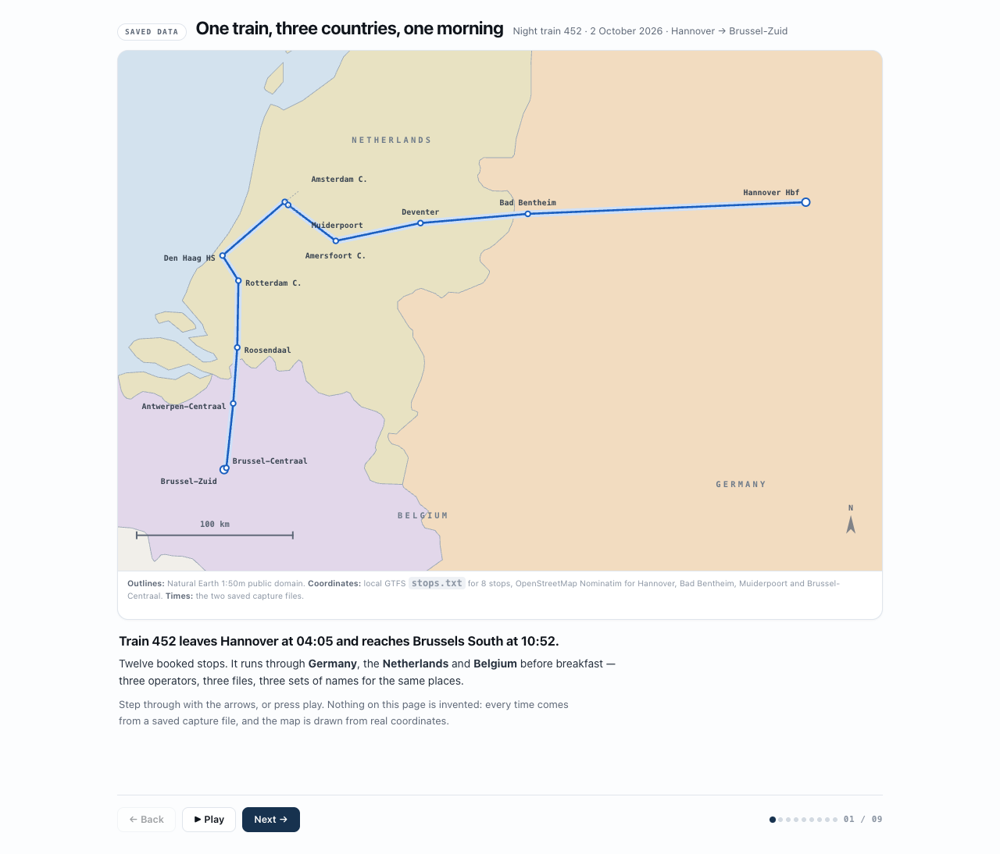
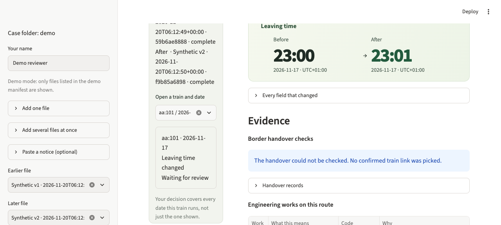

# Nightdesk

A change desk for a cross-border night-train operator.

Two separate things live in this repo, and you can use either without the other:

1. **A data pipeline.** It fetches train data from several European railway APIs, saves every
   pull as a file with its source, licence and capture time, and can compare two pulls of the
   same source. Useful on its own if your problem is "we need train data from several countries
   in one shape".
2. **An example tool.** A local desk where an operations planner sees what changed between two
   pulls, checks the border handover, records a decision and exports a receipt. Useful if your
   problem is "two countries disagree about the same train and someone has to decide".



*The explainer at [`docs/explainer-train-452.html`](docs/explainer-train-452.html) walks through
one real morning of train 452 — same train, three countries, three files.*

---

## Try the example first (offline, no keys)

```sh
uv sync
uv run nightdesk demo check     # verifies the demo files by hash; no network
uv run nightdesk demo serve     # opens the desk on 127.0.0.1
```

The demo runs on CC0 and synthetic files only. Nothing it shows is live, and nothing leaves the
machine.

Without `uv`, use a Python 3.12 virtualenv:

```sh
python3.12 -m venv .venv
.venv/bin/pip install -e ".[test]"
.venv/bin/nightdesk demo serve
```



*The desk: what changed, where it came from, the border-handover check, and the work records
that may explain it — for one train and one date.*

---

## Add your keys

Every source is optional. The Belgian file needs no key at all, so you can start with an empty
key file.

```sh
cp .env.example .env      # then fill in the keys you have
uv run nightdesk doctor   # shows which sources are ready, never prints a key
```

Keys are read from `.env` in the project root, or from one machine-wide file at
`~/.agents/secrets/nightdesk.env` (mode 600) so every checkout on the same machine can use them.
A real environment variable always wins over both files, and `.env` is git-ignored.

`nightdesk doctor` tells you exactly which variable is missing for each source and where to get
it. It never prints a value.

---

## What the pipeline can fetch

| Source | Country | What it gives | Key |
| --- | --- | --- | --- |
| Infrabel punctuality | Belgium | Monthly punctuality file, CC0 | none |
| Infrabel D-1 | Belgium | D-1 train reports | none |
| NS maintenance | Netherlands | Engineering works | `NS_API_KEY` |
| Rijden de Treinen archive | Netherlands | Saved archive reports, CC BY 4.0 | none |
| DB OpenBoards | Germany | Station departures and arrivals, planned and current | `DB_CLIENT_ID` + `DB_API_KEY` |
| Swiss SIRI | Switzerland | Planned disruptions | `SWISS_OTD_TOKEN` |
| Train Archive | Europe | Daily trips by train number | `TRAIN_ARCHIVE_TOKEN` |
| Local GTFS | any | Timetable file you already have | none |

**Status note.** The German source has two commands. `fetch-db-boards` uses OpenBoards, the
subscription you need now; `fetch-db-timetables` still calls the older Timetables endpoints, which
are being retired (new subscriptions closed in November 2026, switch-off planned for mid-2027), so
use the board command. One pull saves both a departures and an arrivals file for the station.

```sh
# one station, or several in one run
uv run nightdesk fetch-db-boards --bundle practice --eva 8000207 --eva 8011160 --limit 50
```

`--eva` is the station number. Verified on 2026-11-20: `8000207` is Köln Hbf and `8011160` is
Berlin Hauptbahnhof. A board covers a short window from the time you ask, so running the same
command each day builds a series of snapshots you can compare later.

To run it on a schedule, add one line to `crontab -e` (07:00 every day, log kept next to the data):

```
0 7 * * * cd /path/to/nightdesk && uv run nightdesk fetch-db-boards --bundle practice --eva 8000207 --eva 8011160 >> data/out/db-daily.log 2>&1
```

Each fetch saves a capture folder with the raw response, a hash, the source URL and the time it
was pulled. Later steps never re-fetch; they read the saved file. That is why the desk works on
a train with no wifi.

---

## How a planner uses the desk

1. Pick the case folder and two pulls of the same source — an earlier file and a later file.
2. The desk lists the trains whose records changed, and why the checks gave a different answer.
3. Open one train: the changed field, the row it came from, the border-handover check and any
   engineering works on that route.
4. Record a decision — accepted, rejected or needs an answer — with a reason.
5. Export the dossier. Every action is appended to a hash-chained history that cannot be edited
   in place.

---

## What it will not do

- It never says "train 452 will be late". It shows two labelled facts and leaves the decision to
  a person.
- A train missing from a file is not a cancelled train. It may be outside what that file covers.
- A changed hash chain proves the history was not edited — not that the data is true.
- It never matches station names by similarity. A Dutch name and a Belgian name are linked only
  after someone confirms it, and the confirmation is recorded.

---

## Build on it

```
src/nightdesk/
  adapters/   one module per source: fetch, save a capture, never normalise silently
  intake/     read a file, check it against a mapping, store an immutable revision
  changes.py  compare two revisions of the same source
  border.py   one narrow consistency rule on adjacent linked path legs
  match.py    exposure grades: rejected, no match, unlocated, B, A, time unknown
  review.py   a local decision bound to a revision
  audit.py    append-only hash-chained history
  ui/         the Streamlit desk (presentation only; every number comes from a report)
tests/        the full suite, offline
mappings/     one reviewed YAML per source: columns, types, units, assumptions
```

Start here: run the tests, open `src/nightdesk/cli.py` to see every command, then read
`mappings/infrabel_punctuality.yaml` as a complete example of a reviewed mapping.

```sh
uv run pytest -q
```

---

## Data and licences

Captured data lives in `data/` and is git-ignored. Only reviewed mappings, code and synthetic
fixtures are committed. Files with unclear or restricted licences (German snapshots, ProRail,
ViaggiTreno, whereisthe.es) are never committed and never shown in the demo.
